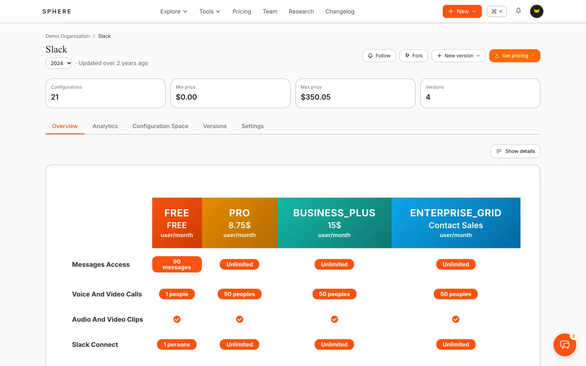
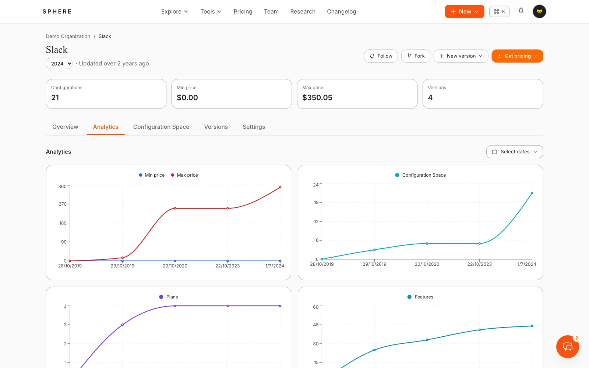
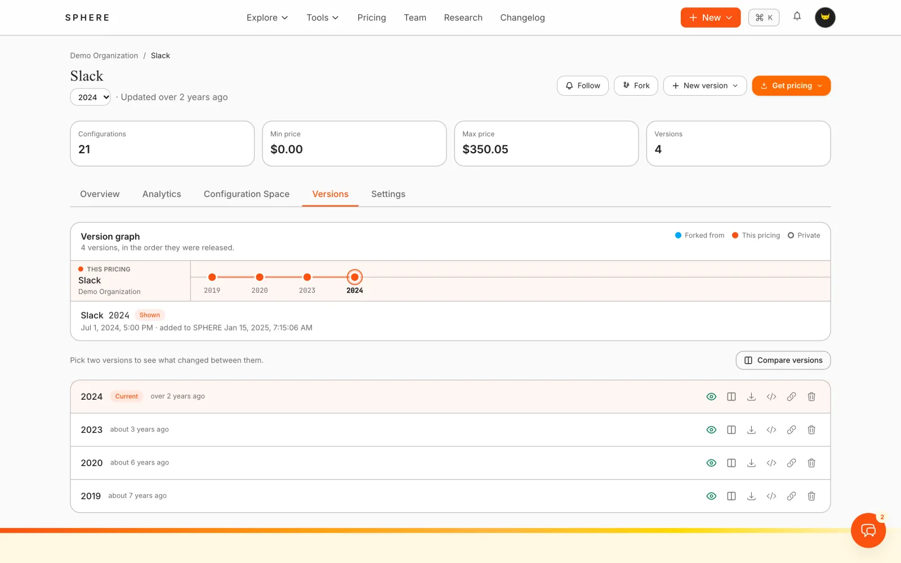

<div align="center">

# SPHERE

**SaaS Pricing Holistic Evaluation and Regulation Environment**

Model, version, analyze and govern SaaS pricings, together.

[](LICENSE)
[](https://github.com/SCORELabUS/SPHERE/releases)
[](https://github.com/SCORELabUS/SPHERE/actions/workflows/run-unit-tests.yml)
[](https://sphere-docs.vercel.app/docs/2.0.1/api/sphere/introduction)

[**Live instance**](https://sphere.score.us.es) · [Documentation](https://sphere-docs.vercel.app/docs/2.0.1/api/sphere/introduction) · [Self-hosting](https://sphere-docs.vercel.app/docs/2.0.1/api/sphere/self-hosting) · [API reference](api/docs/sphere-api-docs.yaml) · [Report an issue](https://github.com/SCORELabUS/SPHERE/issues)



</div>

## About

SaaS pricings change constantly: plans, add-ons, features and usage limits combine into thousands of possible subscriptions, and providers revise them every year. SPHERE treats a pricing as an engineering artifact. Each pricing is written in the [Pricing2Yaml](https://sphere-docs.vercel.app/docs/2.0.1/api/pricing-description-languages/Pricing2Yaml/the-pricing2yaml-syntax) format, kept as a history of versions, analyzed automatically and shared within organizations, with an API and AI assistants on top.

A public instance runs at **[sphere.score.us.es](https://sphere.score.us.es)**. You can also [run your own](#run-your-own-instance).

## Features

- 📚 **Pricing repository.** Upload, edit and version pricings, compare versions, keep some private and group pricings into collections.
- 📈 **Analytics.** The number of possible subscriptions and the price range of each pricing, how they evolve across versions, and the cheapest subscription for given needs, computed with [MiniZinc](https://www.minizinc.org/).
- 🏢 **Organizations and permissions.** Nested organizations, roles, invitations and fine-grained permissions on pricings and collections.
- 🔗 **Permanent and anonymous links.** Stable URLs that survive renames and moves, and links that share a pricing with people who have no account.
- 🤖 **AI assistants.** HARVEY answers questions about pricings; ORBIT reads your workspace and proposes changes as plans you confirm. Both work with OpenAI or a [self-hosted model](https://sphere-docs.vercel.app/docs/2.0.1/api/sphere/self-hosting/ai-assistants).
- 🔌 **REST API and MCP server.** Everything is available through a documented API with API keys, and assistants such as Claude or ChatGPT can use ORBIT's tools through the [SPHERE ORBIT plugin](https://github.com/SCORELabUS/sphere-orbit-plugin).

<table>
  <tr>
    <td width="50%"></td>
    <td width="50%"></td>
  </tr>
  <tr>
    <td align="center"><sub>How a pricing evolves across its versions</sub></td>
    <td align="center"><sub>Version graph and history</sub></td>
  </tr>
</table>

## Quick start

Try SPHERE on your machine with demo accounts and 32 example pricings. You need [Docker](https://docs.docker.com/get-docker/) with Docker Compose 2.30 or later.

```bash
git clone https://github.com/SCORELabUS/SPHERE.git
cd SPHERE/docker/testing
docker compose up -d
```

Open <http://localhost> and sign in as `sphere` with the password `faked`. The first start takes a few minutes while it builds the images and loads the data.

The [local demo guide](https://sphere-docs.vercel.app/docs/2.0.1/api/sphere/self-hosting/run-locally) lists the other demo accounts, what to try and how to add the AI assistants.

> [!WARNING]
> The demo stack ships with default passwords and secrets. Keep it on your own machine.

## Run your own instance

[`docker/self-hosted`](docker/self-hosted) runs SPHERE on your server from the published images: copy `.env.example` to `.env`, set your address and three secrets, and start it with `docker compose up -d`.

| Guide | Covers |
| --- | --- |
| [Deploy your own instance](https://sphere-docs.vercel.app/docs/2.0.1/api/sphere/self-hosting/deploy-your-own-instance) | Configuration, HTTPS, the first account, updates and backups |
| [Enable the AI assistants](https://sphere-docs.vercel.app/docs/2.0.1/api/sphere/self-hosting/ai-assistants) | HARVEY, ORBIT and A-MINT with OpenAI or a self-hosted, OpenAI-compatible model |
| [Configuration reference](https://sphere-docs.vercel.app/docs/2.0.1/api/sphere/self-hosting/configuration-reference) | Every variable of the `.env` file |

Each release publishes the `ghcr.io/scorelabus/sphere-api` and `ghcr.io/scorelabus/sphere-client` images for `amd64` and `arm64`, tagged with the version (such as `2.13.0`) and `latest`.

## Architecture

| Component | Technology | Location |
| --- | --- | --- |
| Web client | React, Vite, Tailwind CSS | [`frontend/`](frontend) |
| API, ORBIT and MCP server | Node.js, Express, TypeScript | [`api/`](api) |
| Database | MongoDB 7 | |
| Cache, rate limits, sign-in state | Redis 7 | |
| Analytics solver | MiniZinc with Gecode | Inside the API image |
| Reverse proxy | nginx | [`nginx/`](nginx) |
| HARVEY, A-MINT and analysis engines | Python, Node.js, Java | [Pricing Intelligence repository](https://github.com/SCORELabUS/Pricing-Intelligence-Interpretation-Process) |

nginx sends `/api/v1` and `/static` to the API, `/harvey-api` to HARVEY and everything else to the web client.

## Documentation

| Document | Content |
| --- | --- |
| [SPHERE documentation](https://sphere-docs.vercel.app/docs/2.0.1/api/sphere/introduction) | Concepts, user guide and self-hosting |
| [API reference](api/docs/sphere-api-docs.yaml) | OpenAPI specification of the REST API |
| [Permanent links](docs/permanent-links.md) | Permanent links, the public synchronization API and SPACE |
| [SCORETech Identity](docs/scoretech-identity.md) | Centralized sign-in (`AUTH_PROVIDER=scoretech`), account linking and rollback |
| [Contributing](docs/CONTRIBUTING.md) | Development setup, tests and conventions |
| [Releasing](docs/RELEASING.md) | How a release is made |
| [`AGENTS.md`](AGENTS.md) | Detailed notes on the codebase for contributors and coding agents |

## Development

You need Node.js 22, pnpm, Docker and MiniZinc with Gecode.

```bash
pnpm run install     # install the API and web client dependencies
pnpm run dev:setup   # start MongoDB and Redis with test data
pnpm run dev         # API on :8080, web client on :5173
pnpm run test        # web client and API tests
```

The [contributing guide](docs/CONTRIBUTING.md) explains the environment files, the repository layout and the conventions for pull requests and commits.

## Contributing

Contributions are welcome. Read the [contributing guide](docs/CONTRIBUTING.md), and report bugs or propose features in [GitHub Issues](https://github.com/SCORELabUS/SPHERE/issues).

## Related projects

- [Pricing Intelligence](https://github.com/SCORELabUS/Pricing-Intelligence-Interpretation-Process): HARVEY, A-MINT and the pricing analysis engines.
- [SPHERE ORBIT plugin](https://github.com/SCORELabUS/sphere-orbit-plugin): use SPHERE from Claude or ChatGPT.
- [SPACE](https://sphere-docs.vercel.app/docs/2.0.1/api/space/introduction): pricing-driven feature toggling for SaaS applications, which can synchronize pricings from SPHERE.

## License

SPHERE is released under the [MIT License](LICENSE). It is a research prototype under active development, provided without warranty of any kind.

## Acknowledgements

SPHERE is developed by the [SCORE Lab](https://github.com/SCORELabUS) within the research of the [ISA Group](https://www.isa.us.es/3.0/) at the University of Seville.
